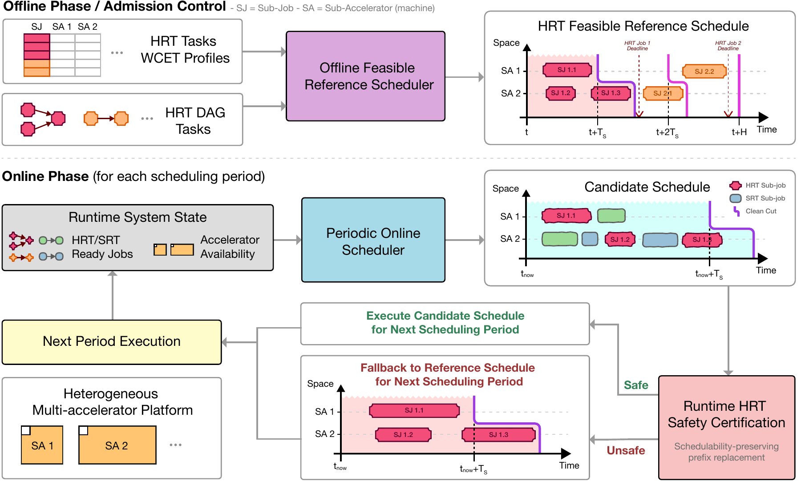
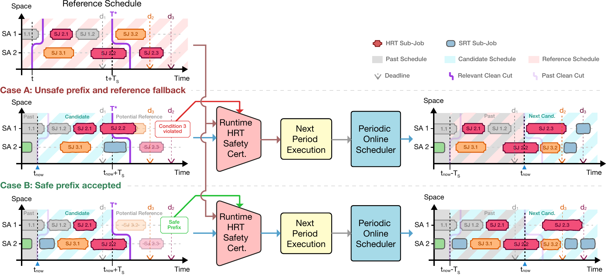
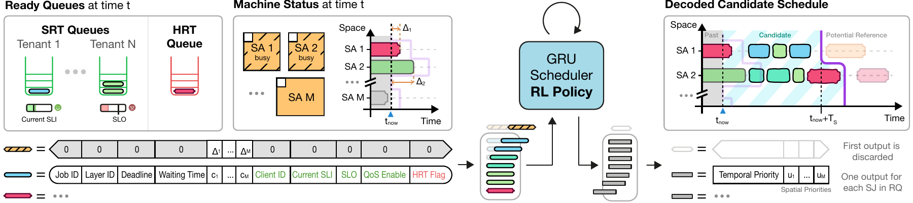

# Hard and Soft Real-Time DNN Inference Scheduling on Heterogeneous Multi-Accelerator Systems via Reinforcement Learning

**RETNAS (Real Time Neural Adaptive Scheduling)** trains a recurrent reinforcement-learning policy to schedule DNN layers on heterogeneous accelerators. In deployment, a deterministic certification layer checks each proposed schedule against an admitted HRT reference and falls back to that reference when necessary. The learned policy optimizes scheduling; the reference and runtime checks protect HRT deadlines.

This folder is a standalone simulator with the code, DNN latency profiles, configurations, tests, and figures needed to run it.



## Install

Use Python 3.10 or newer; Python 3.10 was used for the validation recorded in [VALIDATION.md](docs/VALIDATION.md). Run these commands inside this folder:

```bash
python3 -m venv .venv
source .venv/bin/activate
python -m pip install --upgrade pip
python -m pip install -e . -c requirements-tested.txt
retnas --help
```

On Windows, activate with `.venv\Scripts\Activate.ps1`. CPU execution is sufficient for the quick trials. PyTorch automatically uses CUDA when available. Dependencies are declared in `pyproject.toml`; `requirements-tested.txt` pins the direct runtime versions used for validation; the installation needs package-index access. No Timeloop, Excel, solver, or system-wide installation is required.

Use this source checkout with an editable installation. Paths **inside configurations** resolve relative to this folder; the config filename supplied on the command line resolves relative to your current directory. Absolute paths also work. Run each experiment in a fresh process.

## One-command quick trial

```bash
python scripts/quickstart.py
```

This generates an EDF reference, trains a small scheduler for two episodes, and evaluates it for 25 scheduling periods. It uses the same four DNNs as the main configurations, a smaller neural network, and one HRT task. It is a functionality check, not a trained scheduler suitable for performance comparisons.

To exercise the optional learned-reference route too:

```bash
python scripts/quickstart.py --learned-reference
```

Each invocation creates `outputs/trials/<timestamp>/` containing the exact stage configs, reference, trained actors, checkpoints, TensorBoard logs, per-stage console logs, and `status.json`. Success ends with `Trial complete`. Failures return a nonzero exit code and identify the log to inspect. A reference rejected by admission control must not be used for deployment.

## Required workflow

1. **Optionally train the offline policy** whose actor becomes `wcet_model_path`.
2. **Obtain a validated reference schedule:** either use that offline policy or use the EDF heuristic. At least one successful route is mandatory.
3. **Train the online scheduling policy** with mixed HRT/SRT arrivals.
4. **Test that policy in deployment mode**, with certification and fallback enabled.

The two policies have different inputs. The offline actor does not receive the HRT flag; the online actor does. `wcet_model_path` and `test_model_path` therefore identify different models.

| Stage | `hrt` | `hrt_step_mode` | `next_state_mode` | `hrt_flag_provided_to_the_network` |
| --- | --- | --- | --- | --- |
| Train offline actor | `true` | `all` | `hrt_only_all_periods` | `false` |
| Generate reference with offline actor | `true` | `all` | `hrt_only_all_periods` | `false` |
| Train online scheduler | `true` | `all` | `nonewjobs` | `true` |
| Evaluate deployed scheduler | `true` | `deployment` | `nonewjobs` | `true` |

The CLI checks these combinations. `nonewjobs` means that replay-buffer next states exclude newly arriving work; the environment still generates new HRT and SRT jobs for the actor. `all` lets the policy schedule both classes during training without the deployment fallback. `hrt_only_all_periods` generates every periodic HRT instance and no SRT arrivals.

### 1. Train the offline actor (optional)

```bash
retnas configs/train_wcet.yaml
```

The actor is saved as `outputs/wcet/<run>/actor_last.pth`. This is an offline schedule-construction policy; it does **not** estimate execution times. Execution costs come from the supplied CSV profiles. Set `wcet_model_path` in `configs/reference.yaml` to that actor, or use `--wcet-model` in the next step.

Training is not guaranteed to find a feasible reference for an arbitrary task set. Increase training effort, use EDF, or change the offered HRT workload if admission fails.

### 2a. Generate a reference with the offline actor (optional route)

Replace `<run>` with the directory printed/created by training:

```bash
retnas configs/reference.yaml --compute-wcet --reference-method model \
  --wcet-model outputs/wcet/<run>/actor_last.pth
```

`--wcet-model` overrides `wcet_model_path`. Generation uses every HRT release over the hyperperiod, then validates workload coverage, releases, execution durations, layer precedences, deadlines, and cyclic accelerator conflicts.

### 2b. Generate a reference with EDF (alternative route)

No neural model is needed:

```bash
retnas configs/reference.yaml --compute-wcet --reference-method edf
```

The heuristic uses EDF ordering and earliest-completion accelerator selection. The implementation conservatively subtracts one scheduling period from each relative deadline during EDF construction. It is a sufficient admission test, not a complete schedulability decision procedure: rejection does not prove that no feasible schedule exists.

Both routes write `outputs/reference.yaml` **only after validation succeeds**, preserving an existing file on rejection. The generated schedule is shifted by its minimum slack and validated again before saving. `--wcet-schedule PATH` overrides the destination. There is no silent fallback between the two construction methods.

### 3. Train the online scheduler

```bash
retnas configs/train_scheduler.yaml
```

The CLI first validates `wcet_schedule_path`. Training uses `all`, so training HRT misses are possible and penalized. Output appears under `outputs/scheduler/<run>/`, including:

- `actor_last.pth`: actor after the last completed optimization step; use this for deployment.
- `actor_best_*.pth`: exploration-policy snapshots selected by training metrics.
- `checkpoint.pth`: actor, critic, and optimizer states for inspection.
- `config.yaml` and TensorBoard events.

The supplied standard settings use a GRU hidden size of 192, 6,000 episodes, and 250 steps per episode. This can take substantial time. Use the quick-start script first. Automatic checkpoint resume is not exposed by this release.

```bash
tensorboard --logdir outputs/scheduler
```

### 4. Test the policy with HRT protection

```bash
retnas configs/deployment.yaml --test \
  --model outputs/scheduler/<run>/actor_last.pth
```

Alternatively set `test_model_path` in the deployment config. `--model` overrides it. The default evaluation lasts 10,000 scheduling periods; use `--steps 100` for a shorter run.

The actor hidden size, layer count, accelerator layout, and state-feature settings must agree with its training configuration. Use the same HRT task set, latency profiles, and validated reference at deployment. Regenerate the reference whenever those inputs change. The simulator requires each HRT period to be an integer multiple of the scheduling period.

## Configurations and workloads

All YAML files use a top-level `config:` mapping. The four standard stage files differ only where the workflow requires it; make shared workload/platform changes consistently across them.

| Stable job ID | DNN | Profile |
| --- | --- | --- |
| 0 | AlexNet | `data/00.csv` |
| 1 | InceptionV3 | `data/01.csv` |
| 3 | ResNet50 | `data/03.csv` |
| 7 | YOLOv2 | `data/07.csv` |

IDs are explicit, not positions in a directory listing. Each CSV row is a sequential DNN layer; `latency_0` through `latency_3` contain its four accelerator-type costs. Types 0/1 are Simba large/small and 2/3 are Eyeriss large/small. `sa_types: [0, 1, 1, 2, 3, 3]` instantiates six accelerators.

The simulator consumes the profile cycle counts directly as time units. Printed ns/ms and throughput conversion use the inherited 1 GHz convention (one cycle = one ns); no frequency conversion is performed automatically.

Each `hrt_customers` row is `[customer_id, job_id, period, relative_deadline]`. Customer IDs must be unique, including when multiple customers submit the same DNN.

SRT client workloads, target hit ratios, and deadline factors are configured by `tenant_workloads`, `tenant_targets`, and `tenant_qos`. `dscale` controls the Pareto arrival generator.

## Baselines in the paper

Use a deployment configuration and a validated reference:

```bash
retnas configs/deployment.yaml --simulation --algorithm FCFS --steps 100
retnas configs/deployment.yaml --prema --steps 100
retnas configs/deployment.yaml --cdmsa --steps 100
retnas configs/deployment.yaml --slackstealing --steps 100
retnas configs/deployment.yaml --hardsoft --hardsoft-mode rc --steps 100
retnas configs/deployment.yaml --hardsoft --hardsoft-mode tc --steps 100
retnas configs/deployment.yaml --hardsoft --hardsoft-mode tcsd --steps 100
```

Dispatch alternatives are EDF, SJF, SSJF, FCFS, and LCFS. PREMA, CD-MSA, and the dispatch heuristics use the common deployment certification path. Tang and SSML retain their scheduler-specific admission/placement logic. Tang defaults to FF; `hardsoft_hrt_scheduler: h_edf` selects its H-EDF alternative.

The client-aware RL variant is controlled by `enable_balancing_reward: true`, which adds client features and reward terms. Train a matching actor and use that setting consistently at evaluation; it changes the input width.

## Reading results

- HRT deadline misses must remain zero in certified deployment. The learned-policy test aborts on an observed HRT miss.
- `HRT jobs still open at test end` are unfinished jobs at the finite horizon, not necessarily misses. Hit ratios use all arrived jobs as the denominator, so an HRT hit ratio below 100% alone does not imply a violated deadline.
- `WCET won` is the fraction of certified candidate decisions that used the reference fallback. Rejection reasons are printed at the end of learned-policy tests.
- Throughput counts **dispatched layer subjobs** per simulated second, not completed DNN requests per second.
- Short runs can leave clients unobserved; inherited per-client summaries display zero for clients with no arrivals. Do not treat those entries as measured SLO failures.
- Quick-trial SRT quality is intentionally not an acceptance criterion. Two training episodes do not establish useful scheduling performance.

## Tests and layout

```bash
python -m unittest discover -s tests -v
```

```text
configs/                 Explicit stage configs and small trial variants
src/retnas/              GRU policy, training, simulation, certification, baselines
data/                    Four timing-only DNN profiles
scripts/quickstart.py     Isolated end-to-end trial runner
tests/                   Safety and release regression tests
outputs/                 Generated runs (ignored by Git)
```

The supplied figures illustrate the paper's conceptual architecture.





## Maintainer

[Francesco Giulio Blanco](https://github.com/BlancoFrancescoGiulio)

Email: [francesco.blanco@phd.unict.it](mailto:francesco.blanco@phd.unict.it)

License: MIT; see [LICENSE](LICENSE).
